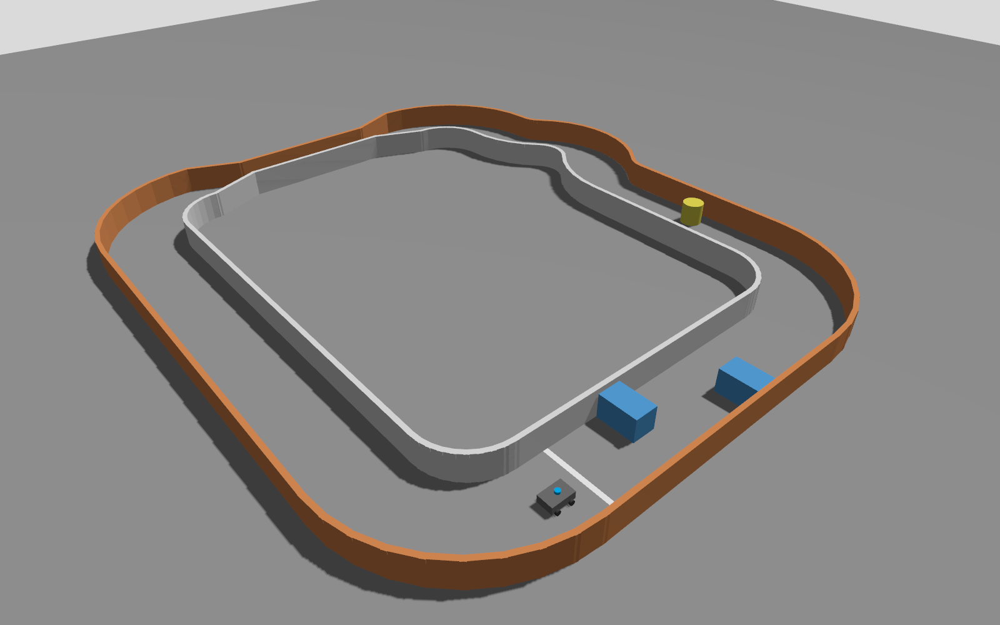
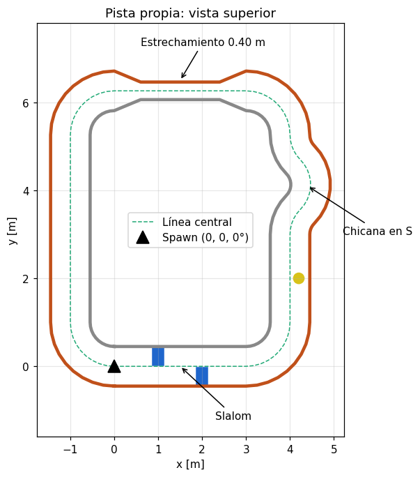
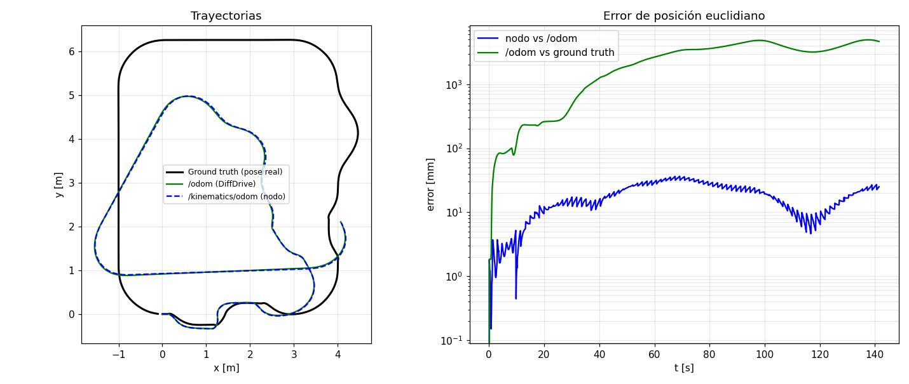

# Robot diferencial en Gazebo (ROS 2 Jazzy)

Robot móvil tipo Yahboom 4WD (skid-steer) con LiDAR y cámara, simulado en Gazebo
Sim (Harmonic) con ROS 2 Jazzy. Incluye una pista propia, un nodo de cinemática
de llantas que compara su odometría con la del plugin DiffDrive, y una
configuración de RViz2.

**Integrantes:** Andrés Ramírez · Simón Patiño



## Estructura

```
ros2_diferencial/
├── docs/                         # Figuras y datos del análisis
└── src/mi_robot_diferencial/
    ├── launch/sim.launch.py      # Launch único: Gazebo + bridge + RSP + spawn + nodo + RViz2
    ├── urdf/robot.urdf.xacro     # Modelo parametrizado (chasis, 4 ruedas, LiDAR, cámara, plugins)
    ├── worlds/pista.sdf          # Pista propia (generada)
    ├── rviz/robot.rviz           # Configuración de RViz2
    ├── mi_robot_diferencial/
    │   ├── kinematics_node.py    # Cinemática de llantas: w -> u -> q̇, integra q y reporta error
    │   └── map_tf_node.py        # TF map -> odom con la pose real (frame fijo para RViz)
    └── tools/
        ├── generar_pista.py      # Genera worlds/pista.sdf a partir de la línea central
        ├── plot_pista.py         # Vista superior de la pista
        ├── prueba_recorrido.py   # Recorrido automático de prueba + registro de odometrías
        └── analizar_recorrido.py # Gráficas y métricas de error
```

## Dependencias

- Ubuntu 24.04 + ROS 2 Jazzy
- Gazebo Sim Harmonic (incluido con `ros-jazzy-ros-gz`)

```bash
sudo apt install ros-jazzy-ros-gz ros-jazzy-xacro ros-jazzy-robot-state-publisher \
                 ros-jazzy-rviz2 ros-jazzy-teleop-twist-keyboard python3-matplotlib
```

## Compilación

```bash
git clone https://github.com/simonpatzul/ros2_diferencial.git ~/ros2_diferencial
cd ~/ros2_diferencial
source /opt/ros/jazzy/setup.bash
colcon build --symlink-install
source install/setup.bash
```

## Ejecución

Terminal 1 — simulación completa (un solo launch):

```bash
ros2 launch mi_robot_diferencial sim.launch.py
```

Argumentos opcionales: `headless:=true` (Gazebo sin GUI), `rviz:=false`,
`world:=<ruta.sdf>`, `x:=`, `y:=`, `yaw:=` (punto de spawn, por defecto en la
línea de salida `(0, 0, 0)`).

Terminal 2 — teleoperación:

```bash
source ~/ros2_diferencial/install/setup.bash
ros2 run teleop_twist_keyboard teleop_twist_keyboard
```

> Recomendado: bajar la velocidad lineal a ~0.15–0.2 m/s (tecla `x`) para pasar
> el estrechamiento de 0.40 m.

Terminal 3 — error entre odometrías:

```bash
ros2 topic echo /kinematics/position_error
```

## Tópicos

| Tópico | Tipo | Dirección del bridge |
|---|---|---|
| `/cmd_vel` | `geometry_msgs/Twist` | ROS → Gazebo |
| `/odom` | `nav_msgs/Odometry` | Gazebo → ROS (DiffDrive) |
| `/ground_truth/odom` | `nav_msgs/Odometry` | Gazebo → ROS (pose real, solo para análisis) |
| `/tf` | `tf2_msgs/TFMessage` | Gazebo → ROS (`odom → base_footprint`) |
| `/joint_states` | `sensor_msgs/JointState` | Gazebo → ROS |
| `/scan` | `sensor_msgs/LaserScan` | Gazebo → ROS (frame `lidar_link`) |
| `/camera/image_raw` | `sensor_msgs/Image` | Gazebo → ROS (frame `camera_optical_link`) |
| `/camera/camera_info` | `sensor_msgs/CameraInfo` | Gazebo → ROS |
| `/kinematics/odom` | `nav_msgs/Odometry` | Nodo propio |
| `/kinematics/position_error` | `std_msgs/Float64` | Nodo propio |

### Frames y RViz

RViz usa `map` como frame fijo. `map_tf_node` publica `map → odom` con la pose
real del simulador (`/ground_truth/odom`), así la pista y el LiDAR se quedan
quietos aunque la odometría por ruedas derive al girar (derrape del 4WD).
El TF `odom → base_footprint` sigue siendo el del plugin DiffDrive.

```
map ─(map_tf_node)─> odom ─(DiffDrive)─> base_footprint ─> base_link ─> ruedas, lidar_link, camera_link
```

## Pista



La pista se genera con `tools/generar_pista.py` (no editar el `.sdf` a mano):

```bash
cd src/mi_robot_diferencial
python3 tools/generar_pista.py > worlds/pista.sdf
```

Circuito cerrado de ~21 m: recta de salida con slalom (2 cajas), 4 curvas de
90° (R = 1 m), recta con obstáculo cilíndrico, chicana en S (R = 0.8 m) y un
estrechamiento de 0.40 m. Corredor normal de 0.90 m, muros de 0.30 m de alto
con colisión.

## Prueba de recorrido y análisis de error

Con la simulación corriendo (`headless:=true rviz:=false` es suficiente):

```bash
python3 src/mi_robot_diferencial/tools/prueba_recorrido.py docs/recorrido.csv
python3 src/mi_robot_diferencial/tools/analizar_recorrido.py docs/recorrido.csv docs/analisis_error.png
```



Resultados de una vuelta completa (141 s):

| Comparación | Error medio | Error máx. |
|---|---|---|
| Nodo propio vs `/odom` | 18 mm | 36 mm |
| `/odom` vs pose real | 2.6 m | 4.95 m |

El nodo reproduce la odometría del plugin; ambas divergen de la pose real porque
un robot 4WD skid-steer derrapa al girar: la odometría por ruedas estimó 477°
de giro total contra 354° reales (separación efectiva ≈ 0.243 m vs 0.180 m
geométrica).
